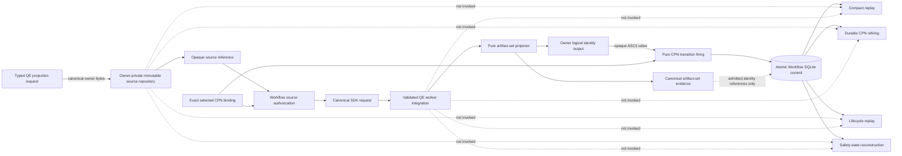

# Schematic

Private owner payload bodies and filesystem locators stop at the owner boundary.
Workflow durably retains compact identities, admitted source-authority
references, canonical CPN transcript evidence, lifecycle state, and markings.
