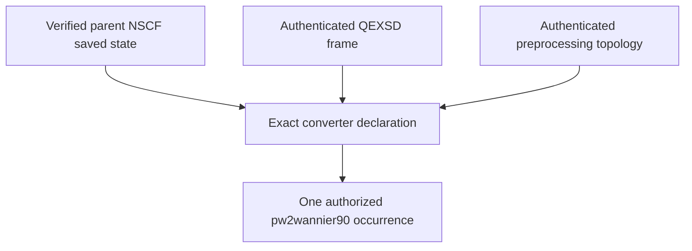
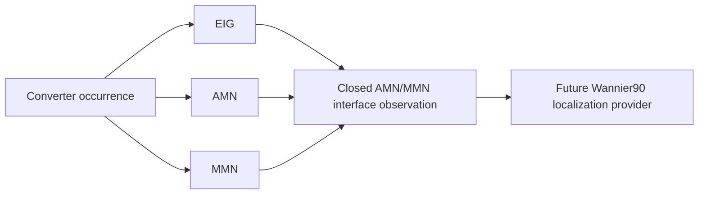
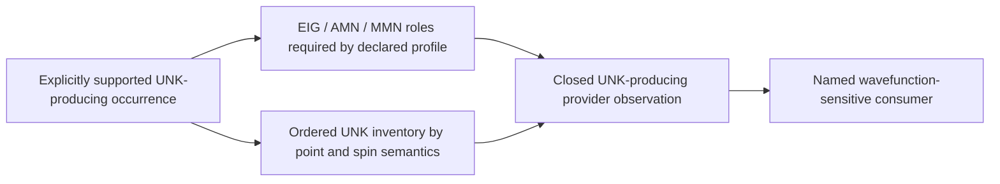
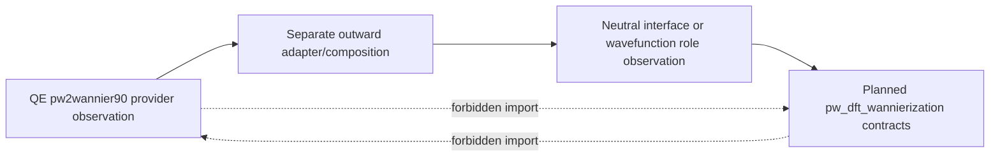

# `pw2wannier90` route-specific artifact closure schematics

## Shared predecessor evidence

Both route profiles begin from exact provider predecessor evidence:



The declaration does not grant execution authority. The converter occurrence is
separately admitted and produces only the roles declared for its route.

## AMN/MMN localization route



The closure also correlates the exact NNKP and parent identities. No UNK edge is
required. Localization outputs are not converter artifacts and do not enter
this closed set.

## Explicit UNK-producing route



The specialized route may share roles with ordinary localization, but it has a
distinct declaration, storage policy, dimensional checks, and consumer. The
existence of this profile does not add UNK to the ordinary route.

## Route closure decision

```text
role declared required + exact artifact present + identity verified
  + producer occurrence matches + dimensions/order correlate
  -> provider role satisfied

otherwise
  -> explicit failed or inconclusive closure
```

An expected basename alone never satisfies a role. An enum member alone never
makes a route supported. Unknown extra selected artifacts in the retained-
evidence manifest are reported and handled by the declared policy rather than
silently promoted. Incidental private work-directory files may be ignored or
separately inventoried; the closed set governs retained route evidence.

## Outward adaptation boundary



The adapter imports both public contracts and records the exact mapping. QE
integration code remains unaware of neutral workflow types; neutral workflow
code remains unaware of QE types. No adapter is implemented by these documents.

## Current-versus-target status

Current configuration, execution, and inspection already support the ordinary
AMN/MMN/EIG converter outputs. The first complete route closes their exact
parent/NNKP lineage in a first-party adapter without replacing the provider
manifest or inspector. Configured UNK production remains rejected; the separate
existing provider manifest keeps its specialized UNK correlation meaning.
These diagrams do not change current APIs or claim UNK production works.
