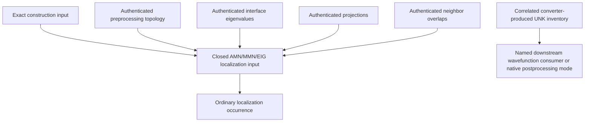
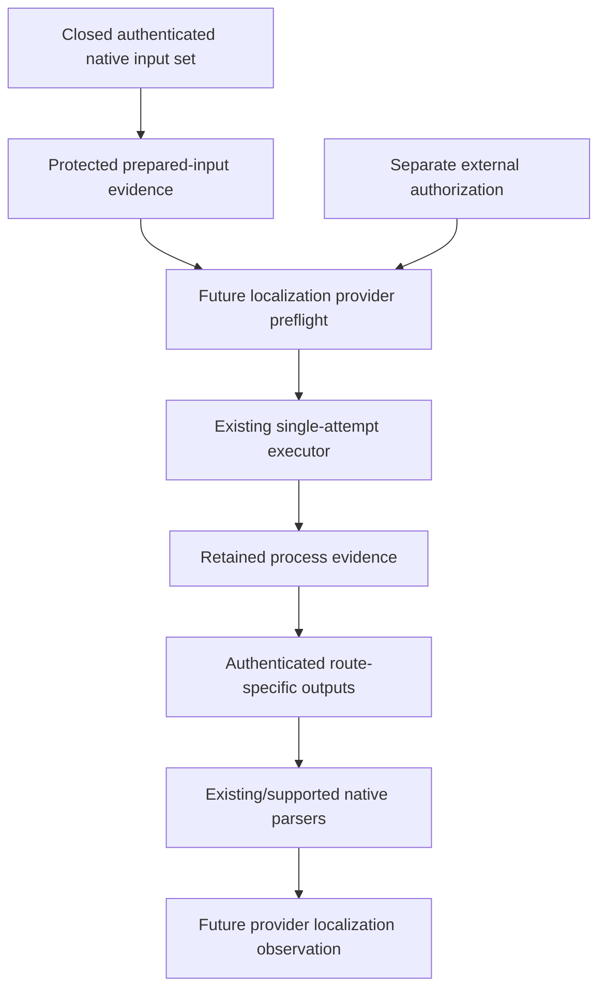
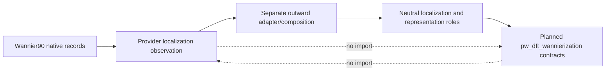

# Planned Wannier90 localization execution schematics

## Route-specific input and sibling evidence closure



UNK is a correlated sibling extension, not an ordinary localization input.
There is no UNK-to-localization edge. Such an edge may be introduced only by a
separately reviewed, explicitly supported native mode that actually consumes
UNK and declares its staging contract. Without that mode, the localization
runner rejects UNKs as undeclared inputs while downstream composition may still
correlate them with the same parent and construction.

## Future occurrence flow



Prepared inputs and predecessor success are not authority. The future runner
submits at most one localization process. It does not automatically invoke any
other stage.

## Process, convergence, and acceptance

```text
zero return code
  -> process-completion observation
  -> required-output authentication
  -> native parsing
  -> provider-reported localization-status observation
  -> route-level dimensional and lineage correlation
  -> outward neutral adaptation
  -> consumer-owned numerical/scientific assessment
```

Every arrow can terminate in explicit failed or inconclusive evidence. No arrow
is an implication of scientific success. Provider-reported convergence remains
an observation from exact native output, not a ProjectKoios acceptance decision.

## Outward neutral adaptation



The ProjectKoios simulations distribution must provide this first-party
`projectkoios.adapters` surface outside both protected dependency closures,
where it may import both public surfaces. The mapping retains exact source artifact, provider schema, parent,
and adaptation identities. It must not copy native provider objects into
neutral records or reinterpret scientific acceptance.

## Failure and retry isolation

```text
occurrence A inputs -> occurrence A outputs/failure record

retry authorization + new occurrence identity
  -> occurrence B inputs -> occurrence B outputs/failure record
```

Occurrence B does not overwrite A. A restart, if a future route supports it,
adds exact checkpoint lineage and still creates a new occurrence. Partial
native output from A may remain evidence but cannot satisfy B's required roles
unless a reviewed restart contract explicitly binds it.

## Current-status boundary

Current code can parse supported caller-supplied `.wout`, matrix, neighbor, and
Hamiltonian artifacts. The future preflight, runner, staging, output-manifest,
and provider-result boxes do not exist. These diagrams do not create APIs,
authorize execution, stage UNK into ordinary localization, make UNK mandatory,
or establish localization or scientific acceptance.
