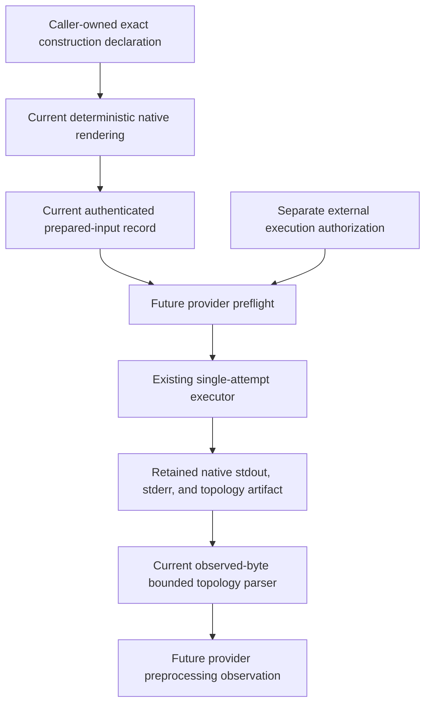
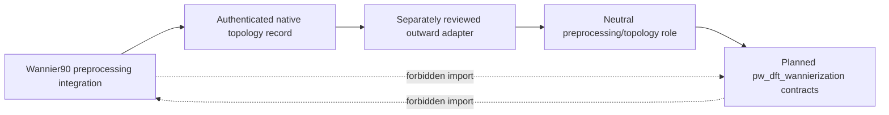

# Planned Wannier90 preprocessing schematics

## Provider occurrence flow

The diagram describes a future provider occurrence, not current executable
behavior.



Neither the declaration nor prepared input carries reusable authority. The
future provider preflight verifies exact executable and input identities, but
it does not create authority. The existing executor starts at most one process
for the occurrence.

## Render-only branch

```text
exact construction declaration
  -> construct and validate typed provider-native input
  -> render exact input bytes
  -> report the input and NNKP basenames
  -> optionally prepare an authenticated CalculatorInputRecord
  -> stop
```

Render-only operation stops before executable resolution, output-process
creation, or native execution. It may be used by tests and inspection tools,
but it does not establish that an input is scientifically accepted.

## Native and neutral boundary

The provider output remains native until an outward composition maps it to a
neutral role:



The adapter is not implemented by this documentation. The ProjectKoios
simulations distribution must provide it through a reviewed first-party outward
`projectkoios.adapters` surface; consuming applications may reuse the same
public contracts.
It imports public contracts from both sides and records the exact mapping. It
does not cause either production owner to import the other.

## Success and failure separation

```text
process returned zero
  != required topology artifact authenticated
  != native topology parsed
  != construction declaration correlated
  != neutral handoff assembled
  != scientific construction accepted
```

Each equality is intentionally false. A later stage may consume only the
specific verified predecessor required by its contract. Missing or inconsistent
evidence produces a requirement, rejection, or inconclusive outcome; it does
not trigger an automatic converter or localization process.

## Occurrence isolation

A future output layout may retain separate input, process, and artifact
manifests, but its exact schema is not fixed here. The invariants are:

- a new occurrence uses a new nonsymlink output directory;
- staged input bytes are immutable for that occurrence;
- stdout and stderr remain separate retained artifacts;
- the terminal execution record is written before a process result is exposed;
- the topology artifact is authenticated before parsing;
- partial failure artifacts remain associated with the failed occurrence; and
- retries never replace an earlier occurrence.

## Status boundary

The rendering and prepared-input boxes correspond to the current `render()`
and `prepare()` methods on `Wannier90PreprocessingInput`. Observed-byte parsing
of caller-supplied `.nnkp` content corresponds to
`Wannier90PreprocessingNnkpOutput.parse()`. Its explicitly named source-
verification method checks the currently supported ordered semantics using
Pint-backed PhysKit quantities. Retained-artifact identity and replay
verification remain future execution-evidence work, as do preflight, execution,
complete semantic verification, and the provider observation. ProjectKoios
does not invoke `wannier90.x -pp`; these diagrams
grant no execution authority and establish no numerical or scientific
acceptance.
