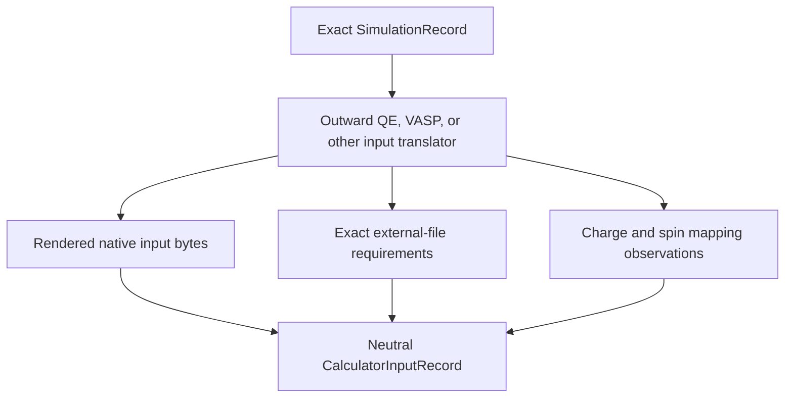
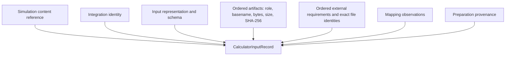
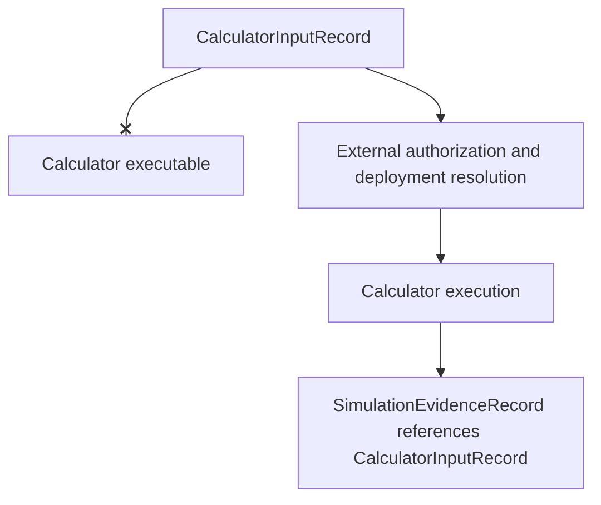
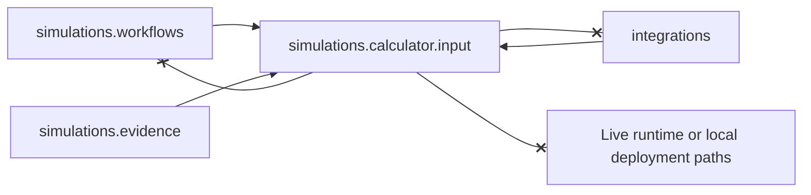
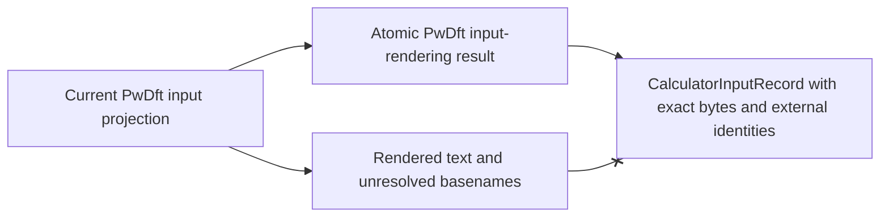

# Prepared calculator-input schematics

## Preparation flow

The translator is outward; the returned immutable record is protected-core data.

## Content identity

Any changed file bytes, order, external identity, integration, or source
simulation creates a different complete record.

## Execution and evidence boundary

The crossed edge means a prepared record alone cannot start a calculator.

## Dependency direction

## Existing API migration

There is no period in which evidence may ambiguously reference either form.
