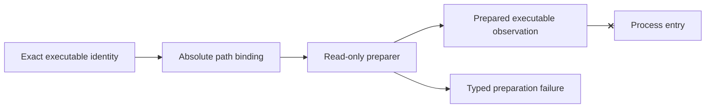

# `CalculatorExecutablePreparer`

`projectkoios.simulations.execution.CalculatorExecutablePreparer` owns one
`CalculatorExecutableBinding` and performs read-only, fail-closed preparation.
It uses `lstat` for initial classification, opens the final path read-only with
`O_NOFOLLOW` where supported, rechecks descriptor metadata, compares byte size,
and computes SHA-256 incrementally from the opened file.

The preparer performs no process invocation, version command, workspace
mutation, artifact staging, diagnostic parsing, or scientific validation. It
grants no execution authority. Provider integrations may consume the result,
but provider arguments, native artifacts, and diagnostic policy remain outside
this owner.
