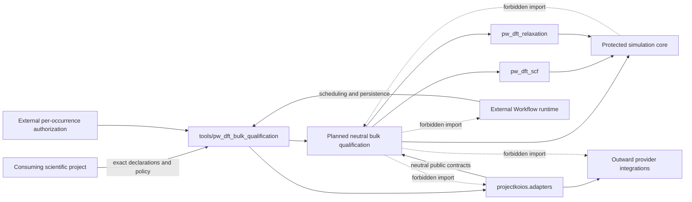
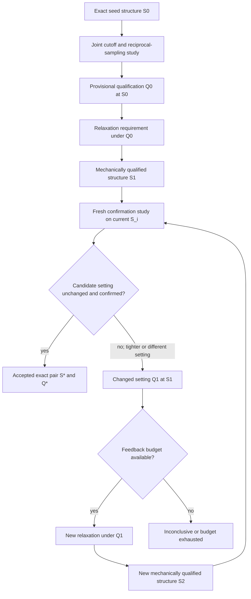
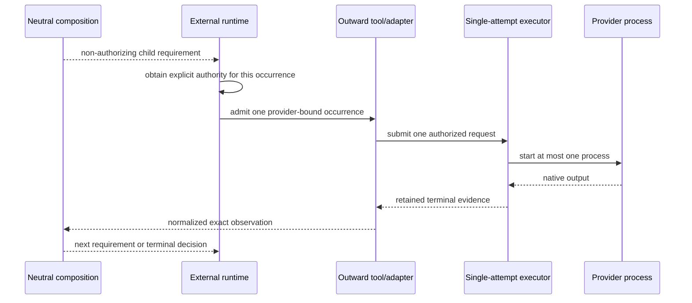

# Plane-wave DFT bulk qualification schematics

## Layer and authority boundary



Arrows into neutral workflow packages are calls through public contracts, not
permission for those packages to import outward callers. Provider selection and
native mapping remain outside the workflow dependency closure.

## Scientific dependency and feedback

The route below is a requirements/evidence graph. No arrow starts a calculator
or grants successor authority.



`Q0@S0` is not rewritten as `Q0@S1`. `S1` is not silently accepted under a
changed `Q1`. Each changed structure, setting, specification, and occurrence
has a distinct identity. The diagram abbreviates repeated iterations; the
actual lineage remains acyclic even though the composition rule feeds a new
iteration.

## Existing grid assessment after a changed cell

```text
exact lattice S_i
  + existing PwDftScfGridConvergenceRecipe and policy
  + neutral wavefunction/density-potential cutoff realization
  + adapter proof for every exact projected input
  -> typed structure/request/occurrence/evidence correlation
  -> accepted existing coordinate and full k-point policy K_i
```

The existing grid assessment is rerun on every relaxed structure, but it becomes
`Q_i@S_i` only through the new typed correlation around its observations and
assessment. Equal integer mesh tuples before and after relaxation remain
separate evidence and require fresh confirmation; no new reciprocal-density
coordinate is introduced.

## Per-occurrence authorization



A retry is a new occurrence. Completion of the provisional study does not
authorize relaxation; relaxation completion does not authorize confirmation;
and a failed confirmation does not authorize re-relaxation.

## Gate to the Wannier route

```text
accepted exact pair (S*, Q*)
  -> exact parent-SCF requirement
  -> exact parent evidence
  -> NSCF
  -> Wannier90 preprocessing
  -> pw2wannier90 interface generation
  -> Wannier90 localization
```

Bulk qualification is a predecessor campaign. The later Wannier route remains
five calculator occurrences beginning with a new parent SCF after pair
acceptance. The confirmation occurrence remains predecessor evidence and is not
reused as the parent by this architecture.

## Status

These diagrams do not define an executable topology, public API, queue,
transition guard, retry rule, executable identity, or authorization token. They
do not show that an adapter, tool, provider capability, qualified structure, or
scientifically accepted route currently exists.
