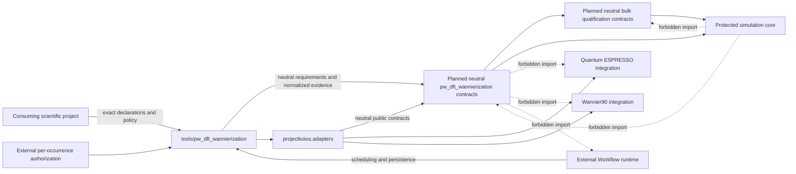
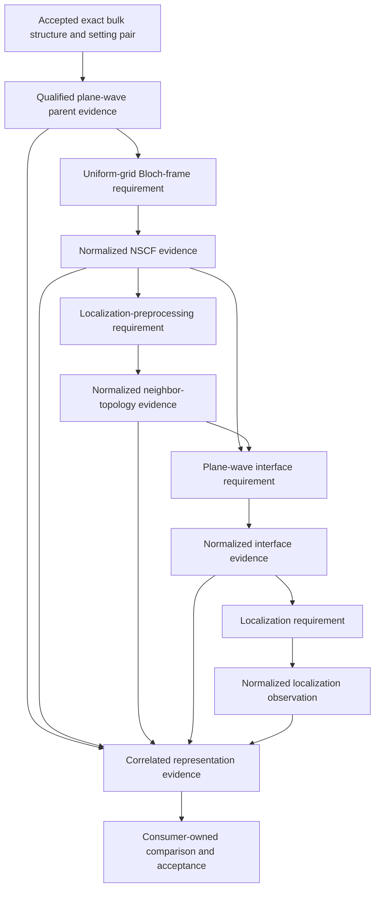
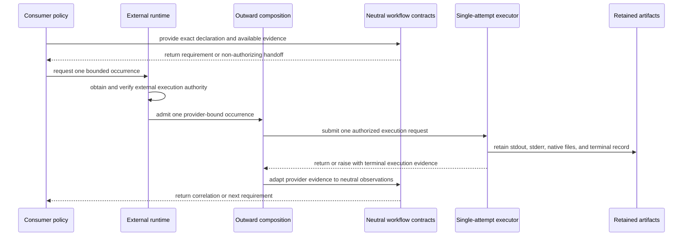

# Plane-wave DFT Wannierization workflow schematics

## Layer and dependency boundary

The planned workflow layer points inward only. The ProjectKoios simulations
repository owns first-party provider selection and route invocation in
`tools/pw_dft_wannierization`, and native/neutral mapping in an outward
`projectkoios.adapters` surface.



The arrows into `workflow` are calls through its public neutral contracts, not
permission for it to import the callers. The protected core does not depend on
the workflow layer. Outward integrations may depend on protected-core ports but
must not import workflow policy in production provider modules.

## Planned scientific route

The following diagram is a requirements and evidence flow. It is not an
executable topology and does not authorize any arrow.



The accepted bulk pair is produced by a separate predecessor campaign with
seed-bound numerical convergence, zero-pressure relaxation, and fresh
final-setting confirmation. It is not an additional hidden occurrence in this
five-occurrence route.

Each evidence node retains exact predecessor identities. No later node may be
constructed merely because expected filenames are present. The representation
must remain traceable to the exact parent state, uniform grid, construction
declaration, normalized interface observations, and localization observation.

## Native adaptation boundary

The neutral workflow names roles by meaning. The first-party adapter maps those
roles to provider-native calculations and artifacts, while the repository tool
invokes the complete route:

```text
neutral parent-state requirement
  -> outward QE SCF binding
  -> exact generic execution/evidence records
  -> neutral parent-state evidence

neutral uniform-grid requirement
  -> outward QE NSCF binding
  -> provider-native saved state and QEXSD parsing
  -> neutral Bloch-frame evidence

neutral preprocessing/interface/localization requirements
  -> future outward Wannier90 preprocessing binding
  -> outward QE pw2wannier90 binding
  -> future outward Wannier90 localization binding
  -> neutral topology, interface, and localization observations

optional declared component-operator requirement
  -> provider-owned coefficient or UNK-bearing route
  -> distinct verified coefficient or sampled-wavefunction observation
  -> explicit transform evidence when the consumer needs another representation
```

The optional extension is absent from a spectral-only profile; its provider
artifacts must not be inferred from basenames or imposed on every route. UNK
samples are not silently relabeled as plane-wave coefficients.

The current Wannier90 integration can authenticate and parse caller-supplied
native text artifacts. The preprocessing and localization binding arrows are
future prerequisites, not current APIs. Adding them requires reviewed outward
architecture and implementation; adding this workflow documentation alone does
not make them available.

## Occurrence and authority flow

Every calculator process is a distinct occurrence admitted outside the neutral
workflow package. The sequence below applies to each of the five route
occurrences after bulk qualification; predecessor qualification occurrences are
separately admitted under their own composition.



The neutral workflow never performs the `R->>R` authority step and never sets
execution authorization. A completed occurrence does not automatically admit
the next occurrence. A failure or inconclusive observation remains retained
evidence and produces no implicit retry.

## Identity chain

A final representation evidence record must preserve a directed acyclic
identity chain rather than a mutable “current result” pointer:

```text
accepted bulk qualification identity
  + exact accepted structure identity
  + exact final numerical-setting identity
      -> parent specification identity
          + prepared-parent-input identity
          + parent occurrence/evidence identity
              -> uniform-grid declaration and evidence identity
                  -> preprocessing declaration and topology identity
                  -> interface declaration and evidence identity
                      -> localization declaration and observation identity
                          -> representation-evidence identity
```

A provisional `Q0@S0` cannot satisfy the accepted-bulk role. If final
confirmation changes the setting on a relaxed structure, the bulk composition
must re-relax and reconfirm before it can publish the predecessor identity used
above.

Changing a structure, pseudopotential, reciprocal grid, band inventory, spin
branch, construction declaration, or provider-native artifact creates a new
identity. It must not rewrite an earlier node or inherit acceptance from it.
Locations are storage references rather than scientific identity; portable
records use exact byte size and digest where artifact bytes are external.

## Status and nonclaims

These diagrams inventory intended boundaries only. They do not define a
complete Petri net, prove that an adapter exists, identify executable paths,
establish native artifact availability, promise dimensional compatibility, or
show that a real route has completed. No diagram grants calculator authority,
numerical convergence, localization convergence, scientific validation, or
publication acceptance.
